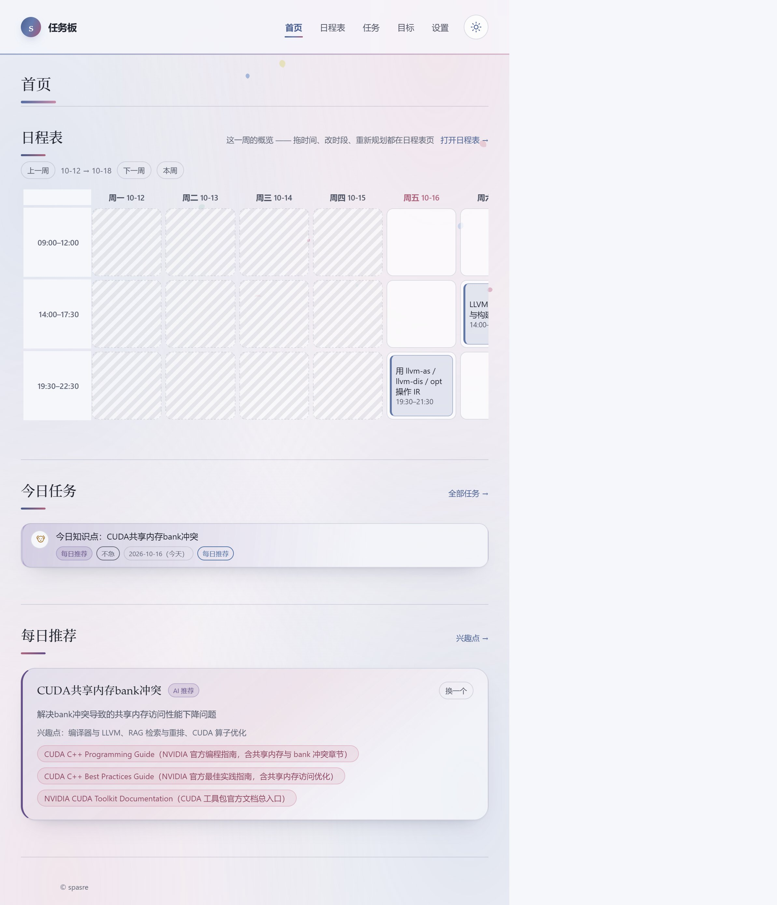
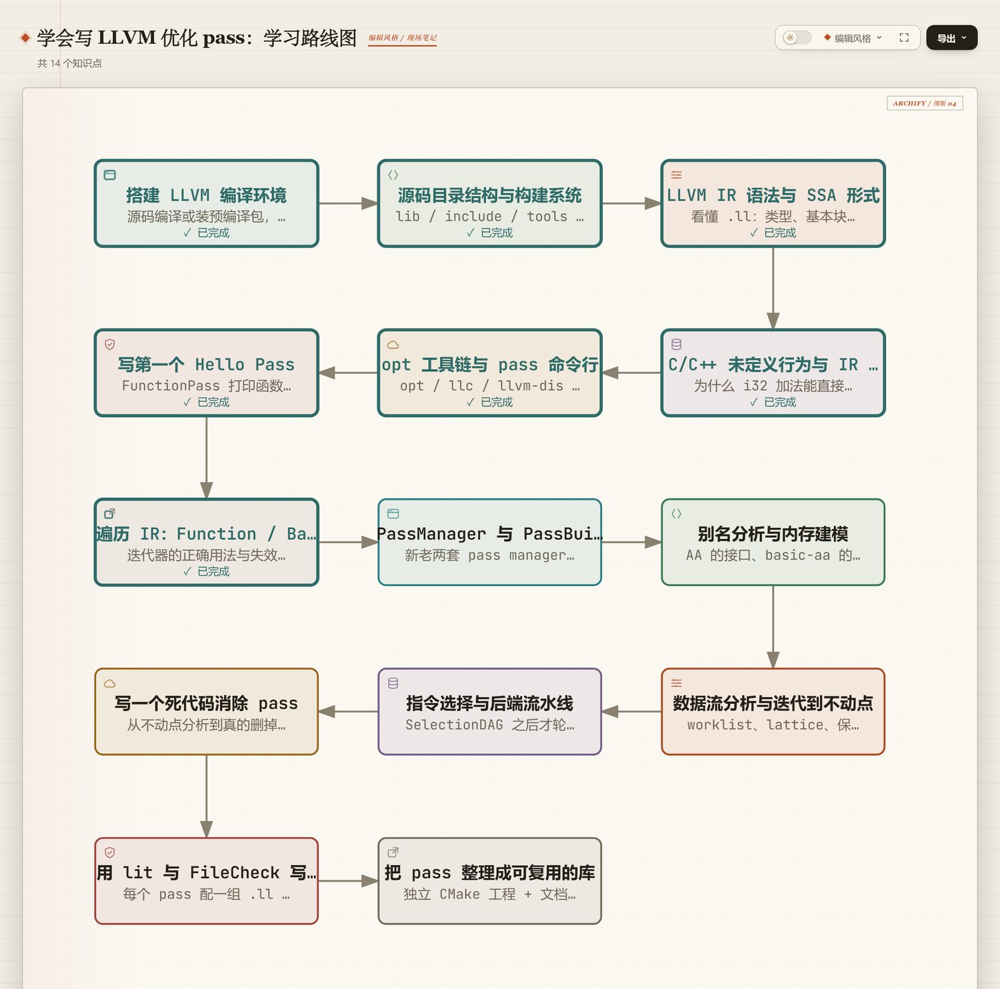
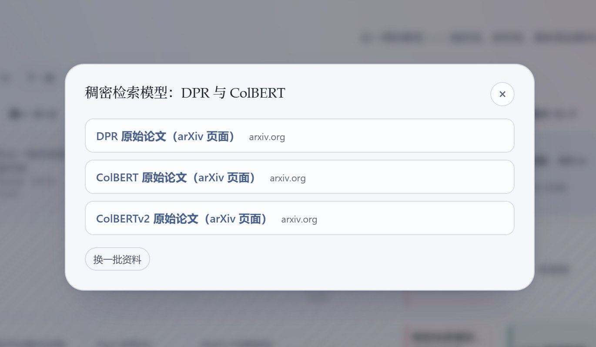
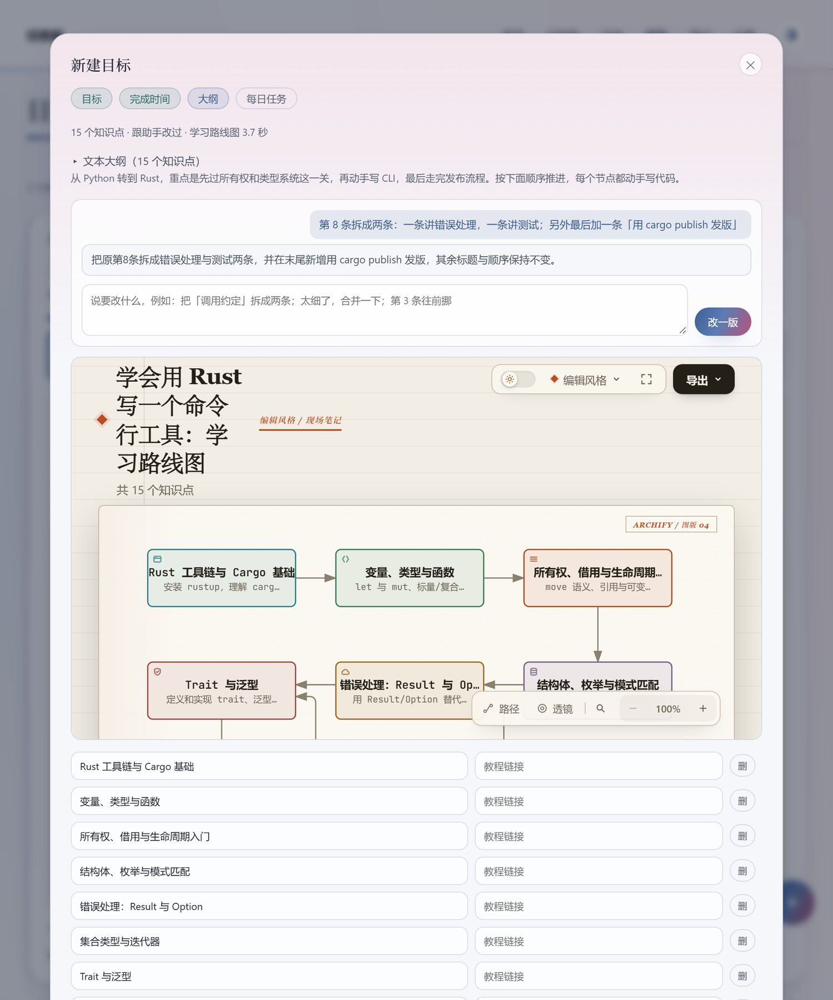
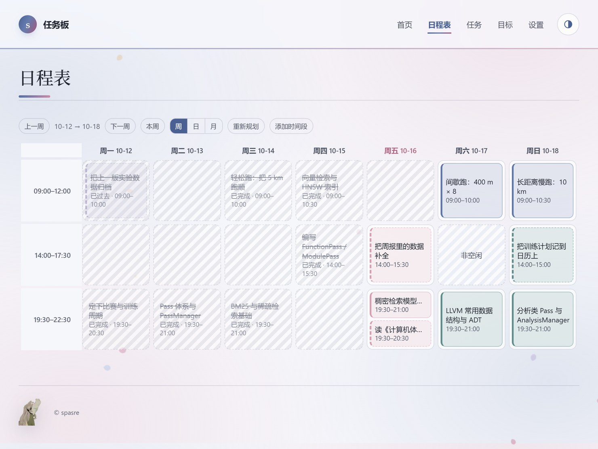
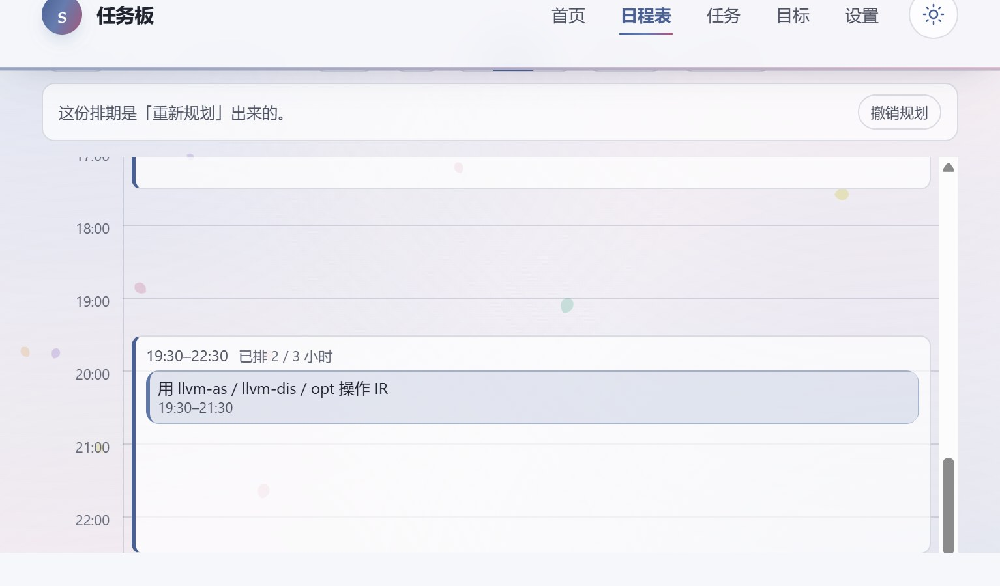
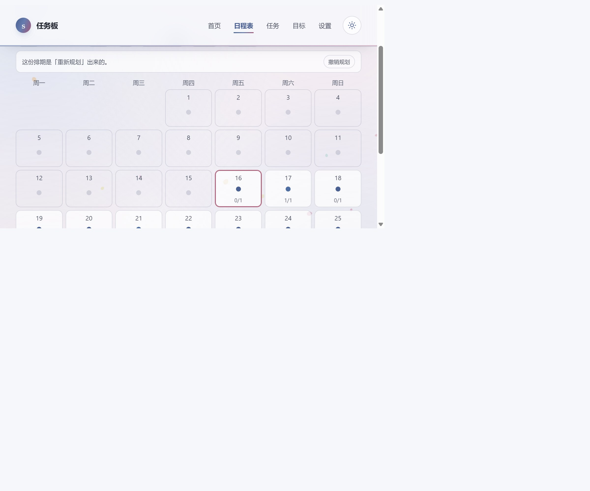
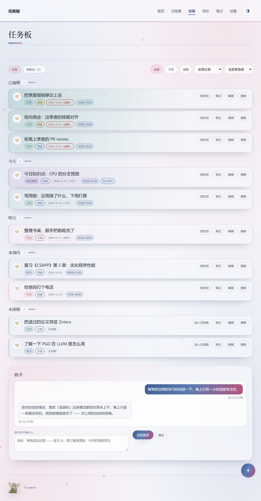
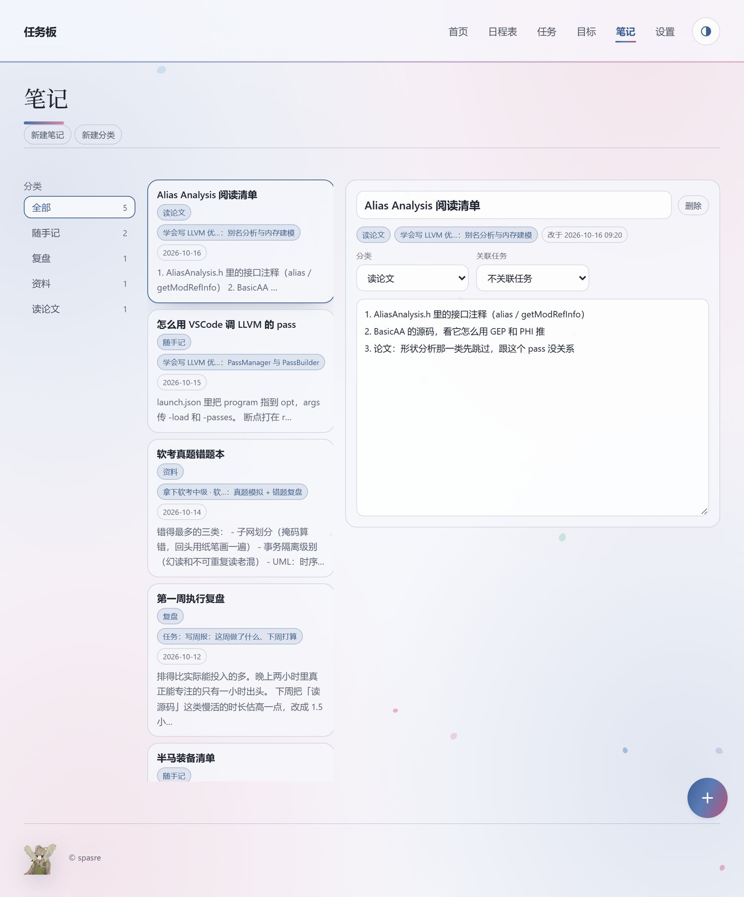
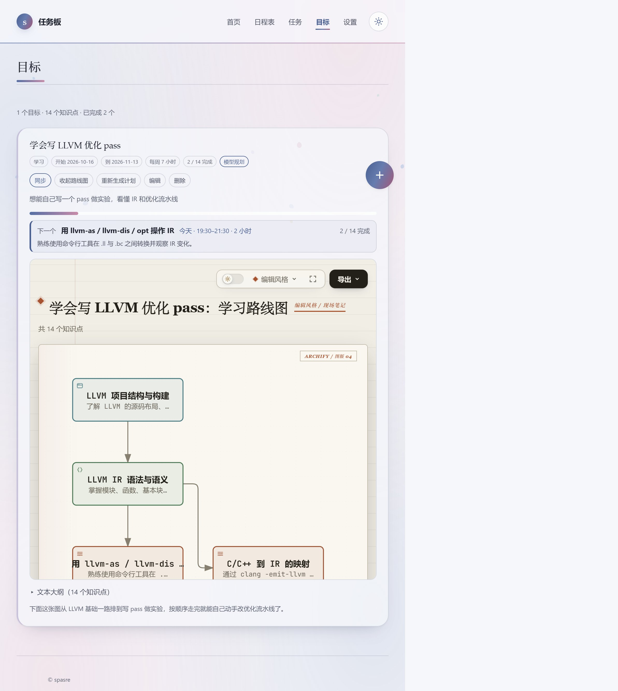

# GoalWeave

一个**本地跑的个人任务板**：今天做什么、什么时候做、为什么做，都摊在同一个界面上，不用在待办清单、课程表和笔记本之间来回切。

它最不一样的地方是**把「长期目标」当成一等公民**：你说一句「我想学会写 LLVM 优化 pass」，它给你拆成一条带前置依赖的知识点路线，画成一张可以缩放的路线图，按你每周能投入的时间**整份排进日程表**，之后你在表上拖一拖改时间就行。想清楚了再执行，而不是每天对着一个空清单发呆。



## 规划是怎么做出来的

一句目标进去，出来的是「一张图 + 一份排期 + 每天该读的资料」，中间是三件事：

**① `learn.curriculum`（拆知识点）** —— 把「学会 X」拆成分阶段的知识点路径。它会先判断这个目标是不是硬核领域（编译器 / 硬件 / 竞赛算法 / 框架开发 / 机器学习这类）：是的话先去抓一份教程大纲再拆，不然直接拆。每个知识点带一句话说明、**前置依赖**（先学谁才能学谁）、大概几小时。前端拿到之后按**最长路径分层**排成 DAG，同一层横着摆，边只从上一层连到下一层 —— 这就是后面路线图和拓扑序排期的骨架。

**② `diagram.roadmap`（画路线图）** —— 把上面那张 DAG 交给后端，用 vendored 的 **Archify**（`skills/vendor/archify`，它会把图校验一遍再渲染）画成一张**能缩放、能导出的独立 HTML**，直接嵌在目标卡里：



**③ `reading.suggest`（找延伸阅读）** —— 每一条知识点（或任务）的「延伸阅读」都由配好的模型现找，后端的 `reading.suggest` 会**挨个真去请求一遍**，404 / 连不上的直接丢掉，所以编出来的链接回不来：



> 没配模型也能用：`learn.curriculum` 有内置的模板兜底（按「打基础 → 上手练习 → 深入原理 → 综合实践 → 输出总结」五步排），拆任务、挑推荐知识点也都有本地方案。只有「延伸阅读」和「路线图」需要后端在跑。

**④ `plan.outline`（改 / 读）** —— 手上那份大纲要改一版，或者要把别处的规划读成知识点，都走它。回来的还是同一份大纲格式（前置写标题，前端换成 id），所以改完路线图能马上跟着重画。

### 新建目标：两种起手式

点右下角 ＋ → 新建目标，先选用哪种：

- **① 先定方向**：只写目标名，加一句补充说明就够。点「下一步」先把大纲出好，顺手按「每条约 1.5 小时 ÷ 每周投入」给一个建议完成时间（先试 `learn.curriculum`：硬核领域它会先抓一份教程大纲再拆）。
- **② 粘贴现成规划**：在别处（另一个 AI、教程、课程安排）聊好的计划，整段贴进来。助手读一遍拆成知识点，把原文里的先后关系、时间范围一起带出来，再用一句话说清「读到了什么、哪处不确定要你核对」。

**第三步两条路一样**：大纲和路线图摆在那儿，下面一个对话框，跟助手一句句改（「第 2 条拆细一点」「太细了，合并一下」「再加一条：读源码」），改完大纲和路线图一起更新；直接改列表里的标题 / 链接也行。觉得可以了按「下一步」，最后「完成，去日程表安排」—— 知识点整份排进日程表。



## 各个页面

| 页面 | 干什么 |
| --- | --- |
| **首页** `index.html` | 这一周日程表的概览 + 今日任务 + 今日推荐的知识点（配图见最上面那张） |
| **日程表** `schedule.html` | 周 / 日 / 月三种看法，拖时间、改时段、重新规划、待安排都在这页 |
| **任务** `tasks.html` | 全部任务（今天 / 明天 / 本周内 / 以后 / 未排期），每条都能开一篇笔记；回收站里那几条也一样有「笔记」 |
| **目标** `goals.html` | 长期目标 → 知识点大纲 → 学习路线图 → 同步进日程表 |
| **笔记** `notes.html` | 分类管着的一堆笔记，能挂到具体任务或知识点上 |
| **设置** `settings.html` | 兴趣标签（含每日推荐开关）、助手配置与导入导出、外观（密度 / 字号） |

新建任务、新建目标都收在右下角的 **＋** 里；主题（跟随系统 / 亮色 / 暗色）在页眉右上角的圆按钮上循环切。

### 日程表：一周怎么用



- **单元格 = 一天 × 一段时间**。一天切成哪几段（这里是 09:00–12:00 / 14:00–17:30 / 19:30–22:30）在设置里改，或点行首的时间标签就地改。
- **拖任务块 = 换时间**：拖到空闲格子上松手就换过去（能接的格子会变虚线）。一格能叠好几项，但**总时长不能超过这一段**，超了会提示然后撤销这次操作。
- **点空格 = 划成非空闲**（再点一下放开），**默认按「每周这一天」记**：划掉周四晚，以后每周四这一格都算忙，排期自动绕开。
- **待安排**在最上面：还没排期的知识点、以及在任务页点过「加入日程表」的任务都列在这儿，拖进格子就排好了。

### 日程表：日视图

一天 24 小时摊成一条时间轴（像日历那样），每一段按自己的开始 / 结束时刻画成一块，里面摆当天排在这段上的知识点和任务；红线是「现在几点」。这一屏只用来「看」，排任务都在周视图那张表上做：



### 日程表：月视图

一天一格，格子里一个**彩点**表示那天的完成情况 —— 蓝=有安排还没做、**绿=全做完**、红=有逾期没做、灰=没安排；格子右下角写 `已完成/总数`，鼠标移上去列出那天具体有什么，点一下就钻到那天的日视图：



### 任务页



### 笔记页

笔记分门别类放着：左边是分类（默认「随手记 / 复盘 / 资料」，可以自己加），中间是这个分类下的笔记列表，右边直接写。



- **和任务、知识点挂上**：在任务卡上点「笔记」、**回收站里那条上也点得到**（做完了回头写复盘正好），或者在路线图的节点面板上点「笔记」—— **已经有笔记就打开那一篇，没有就新建一篇**（标题自动用任务名 / 知识点名，关联也一起记上）。
- 路线图的节点面板只留三样：**知识点名字、那一句说明、一个「笔记」按钮**（加关闭和复制链接）。Archify 自带的那套「语义护照 / 种类 / 架构组件 / 第 N 步 / m1 / N 条出向 · M 条入向 / 编写可达范围」是给架构图用的，都收掉了。
- 笔记能改分类（下拉最后一项是「＋ 新建分类…」），也能重新选关联的任务；列表里会写清这篇挂在哪。
- 写完自动存（停手 0.6 秒落盘），跟着看板数据一起进后端，换台设备打开也是这些。

### 目标页

目标卡：上面是「下一个」和进度，下面就是知识点大纲（默认折叠）和嵌在卡里的学习路线图：



## 计划生成好了，你能怎么改

计划是生成出来执行和微调的，不是拿来当画板画的。能改的地方是这些：

- **改时间**：日程表上把任务块拖到别的格子；或者点任务卡上的「改时段」，会跳到它所在的那一周/那一天并打开面板，在面板里挑日期 / 时段 / 时长。一格容量超了会被挡下来。
- **改时间段**：点日程表行首的时间标签（或「添加时间段」）就地改开始 / 结束、删掉、加一段；有重叠、没填完、结束早于开始都不让保存，顶部会说清哪儿不对。
- **改休息时间**：点空格子划成「非空闲」（默认每周一致），排期自动绕开；再点一下放开。
- **整体重排**：「重新规划」把**没做完的**知识点（含今天往后已经排好的）腾出来重新找位置，做完的和已经过去的保持不动。排完右边会出现 **「撤销规划」**，觉得不合理一键改回去（快照存在本地，刷新之后也还在）。
- **补排**：卡片上的「同步」只把还没排期的知识点排进空段，别的目标手上排好的不动。
- **换一套计划**：卡片上的「重新生成计划」让助手按当前目标重排一份（会覆盖旧计划，并顺手把新的一份排进日程表）。
- **从头来过**：设置页「数据」里的「清空数据」要先把 `确认清空数据` 原样打一遍才放行，清完回到新用户引导。助手配置（`.env` 里的接口地址和密钥）会留着。

## 用它能做到什么

- **学一门新东西**：说一句目标（「学会写 LLVM 优化 pass」「两周把 RAG 检索搞明白」），得到一张有先后顺序的路线图 + 排到具体时段的计划，每天打开首页就知道今天该干哪一步。
- **管住「每天一点输入」**：打开每日推荐，它按你的兴趣标签每天挑一个知识点，配上一句话说明和几条真能打开的阅读资料；不感兴趣就「换一个」，连着换的方向会被记住，下次不再往那边推。
- **把杂事和正事放在一张表上**：临时任务写一句话丢给助手，它拆成几条并挑好分类 / 紧急度 / 日期；该占时间的按「加入日程表」进表，不占时间的就是一条待办。
- **看得见进度**：目标卡上「下一个」写清现在该做哪个知识点、排在什么时候、一共完成几个；月视图一眼看出哪几天欠了账。
- **不联网也能用**：没配模型时拆任务、排学习计划、挑推荐知识点都有内置方案兜底，不会卡在「请先配置」。

## 怎么跑

需要 **Python 3.8+**（只用标准库，不用装依赖）：

```powershell
cd task_board
python server.py --lan      # 双击 serve.ps1 也行；--lan 让同一个 WiFi 下的手机也能打开
```

然后浏览器开 `http://localhost:8777/`。第一次打开会走三步引导：要不要每日推荐 → 挑几个兴趣方向 → 配模型（都能跳过，之后在设置页里改）。

细节（换端口、以新用户身份试一遍、手机 / 局域网、助手配置、第一次排期）都写在 **[QUICKSTART.md](./QUICKSTART.md)** 里。

## 数据存在哪

数据由**后端保存**，所以同一台电脑上换浏览器、清站点数据，看到的都是同一份：

| 位置 | 内容 |
| --- | --- |
| `config/data.json` | 全部数据：任务、回收站、长期目标与知识点、**笔记与笔记分类**、日程表（`schedule.busy` = 用户划掉的非空闲段）、分类、设置、兴趣点、当日推荐（`daily` 是今天推的那条，`meta.dailyServedOn` 记今天这条给出去没有），带一个自增的 `rev` 版本号 |
| `localStorage["spasre-tasks-v1"]` | 同一份数据的兜底副本，只在后端不可达时用（比如 `serve.ps1 -Static` 起的纯静态服务） |
| `localStorage["spasre-tasks-dirty"]` | 本地改动还没推上去的时间戳（跟后端那份比谁新用，推上去了就清掉） |
| `.env`（项目根目录） | 助手配置（接口地址 / 模型 / 密钥），后端读写的就是这个文件 |
| `localStorage["spasre-theme"]` | 明暗模式偏好（`light` / `dark`；没这项就是跟随系统） |
| `localStorage["spasre-look"]` | 外观：密度（`comfy` / `compact`）和字号（`small` / `normal` / `large`） |
| `localStorage["spasre-board-view"]` | 任务页挑的筛选（页签 / 分类 / 紧急度 / 时间范围） |
| `localStorage["spasre-sched-draft"]` | 时间段改了还没按「保存」的那份草稿 |
| `localStorage["spasre-sched-week"]` | 日程表正在看的是哪一周 |
| `sessionStorage["spasre-agent-key"]` | 助手密钥（勾了「记住密钥」就存进数据里，跨浏览器都在） |

一句话：**凡是能改的数据都在 `data.json` 里**（连兴趣标签、聊天记录、每日推荐、非空闲段、时间段都在 `settings` / `chat` / `daily` / `schedule` 里），本机只额外存上面这几个纯界面的偏好 —— 换个浏览器看，数据和这些偏好都能找回来（密钥除外，那是本机会话的）。

同步怎么走：

- 打开页面先用本地那份画出来，接着拉后端：后端有数据就以后端为准重画；后端是空的而本地有数据，就把本地这份推上去（第一次迁移）。
- 之后任何改动都是「先写本地，再防抖 400ms 推后端」。**本地这份还没推上去时（比如刚点完完成就切页、或者那一下写盘没成功），本地的时间戳更新，刷新后会反过来把本地推上去**，不会被后端那份旧的盖回来；切页 / 关标签页前还会用 `sendBeacon` 把攒着的改动补推一次。
- 页面每 5 秒轮询一次，`rev` 比本地新就整份换掉并重画 —— 所以在手机上加一条任务，电脑上最多 5 秒就能看到。
- 写盘偶尔会失败（Windows 上目标文件被杀软 / 索引器短暂占住，`os.replace` 会报 WinError 5）：后端会退避重试几次，前端推不上去也会隔 700ms 再试两次，别让改动悄悄丢掉。
- 后端没起（纯静态）时全部逻辑照旧走本地，不会报错。

`.env` 和 `config/data.json` 里都是明文（密钥就在 `.env` 里），**别外传、别提交**（仓库的 `.gitignore` 已经挡住这两个）。

> 这个 `.env` 只是任务板应用自己的配置文件（`server.py` 自己读、自己写），**不是给终端用的环境变量文件**。
> 所以 `.vscode/settings.json` 里把 `python.envFile` 指到了一个不存在的路径、并关掉了
> `python.terminal.useEnvFile`：免得 VS Code 的 Python 扩展把里面的 api key 注入到集成终端里
> （那样随便哪个脚本都能读到你的密钥）。想让别的 Python 项目用 shell 环境变量时，把这两行改回去就行。

## 备份 / 换台机器

数据全在 `config/data.json` 一个文件里，助手配置全在 `.env` 里，搬这两个就搬走了一切：

- **备份**：复制走就行。`config/data.json` 是纯文本 JSON（`{ rev, updatedAt, store }`），坏了也能自己打开看。
- **换台机器**（或者换目录）：把整个目录带过去，或者只带 `config/data.json` + `.env`，放到新机器上同样的位置。
- **清空看板重来**：设置页「数据」那块点「清空数据…」，输入 `确认清空数据` 就清（后端那份一起清，然后回到新用户引导）。命令行也行：`curl -X DELETE http://localhost:8777/api/data`，或者停掉服务后删 `config/data.json`。
  只想清助手配置的话，设置页的助手卡片里有「导出 / 导入 .env」，导出的文本里也带着密码哈希。
- 想在没起后端的时候也能看到数据，浏览器里那份兜底副本（`localStorage["spasre-tasks-v1"]`）跟后端这份是同一份结构，
  两边都有数据时会以后端为准。

## 新建任务 / 分类

- 右下角 **＋** 打开「新建任务」：任务名、**分类（下拉选）**、紧急程度、日期。
- **分类是个真下拉框**：列着四个默认分类 + 用过/自己加过的分类；最后一项是 **「＋ 新分类…」**，选它会在旁边展开一个输入框填名字，提交时自动登记成一个新分类（以后下拉框里就有它了）。
- 没有分类在用的自定义分类会留在下拉框里（方便复用）；点任务卡片右边能改分类，改的也是同一个框。

## 长期目标是怎么排出来的

新建目标是一个四步向导（右下角 ＋）：**目标 → 完成时间 → 大纲 → 每日任务**。第一步先选怎么起手（见上面「新建目标：两种起手式」）：只写一句方向，或者把别处聊好的规划整段贴进来。

**第三步一次做完**：生成知识点 → 拼出大纲 → 画学习路线图，状态行里报进度（例：`14 个知识点 · 模型生成 · 学习路线图 3.5 秒`）。知识点由 `generateNodes()` 出：**模型 → 后端 `learn.curriculum` 技能 → 内置模板**，逐级回退。

- 第三步的**对话框**就是改稿的地方：说一句要改什么（「第 2 条拆细一点」「太细了，合并一下」「再加一条：读源码」），它走 `plan.outline` 改完大纲、顺手把图重画一版，来回几轮都行；也可以直接在下面的列表里改标题 / 链接 / 删节点。用「粘贴现成规划」起手的话，进第三步第一眼就是它读出来的那份，不合适接着聊着改。

- 每个节点带一条**教程链接**（模型挑的，或技能阶段资料来源），生成后可以在下面的列表里**改标题、改链接、删节点**，上面的大纲跟着变；这时挂着的那张图会被标成旧的，旁边出现「重新画一张」。（**结构本身（加删知识点、连 / 断前置）不在页面上改**：想换一套计划就按目标卡上的「重新生成计划」。）
- 学习路线图交给后端的 `diagram.roadmap`（Archify）：画成一张能缩放、能导出的 HTML，画完就在向导里内嵌预览。地址存进目标的 `diagram` 字段，**目标卡上默认就把图摆出来**（点「收起路线图 / 展开路线图」折叠；重画卡片会把 iframe 接过来接着用，不会每次都重新加载）。卡上还没有图时（比如节点改过、旧图作废了），那儿会留一个 **「画一张路线图」**，点一下现画，不用绕回向导。
- **编辑已有目标**时，进第三步直接摆出存好的那张图（不重跑）；知识点重生成过、图对不上了，才会重新画一次。
- **按钮只在需要时才出现**：平时第三步只有状态行 + 大纲 + 图；出错了（后端没起、Archify 没过校验）或在上面改了知识点，才会冒出一个「重试 / 重新画一张」。
- **第四步只说一句「去哪安排」**：这里会算出这次要花多久（`每周小时 × 天数 ÷ 7 ÷ 知识点数`，半天取整），但**不再列一张「哪天排哪个知识点」的清单** —— 排到哪几天、几点到几点，去日程表上看，那儿还能顺手拖时间和整体重排。**知识点数不能超过这段日子的天数**——超了第三步不放行，会直接说「12 个知识点，可用只有 5 天」。
- 第四步的按钮是 **「完成，去日程表安排」**：**计划在这一步就整份排好**（按空段把知识点一个个排进去，不用自己拖），然后**直接跳到日程表页** —— 在那儿看着改就行；没有空位的会留在日程表顶上的「待安排」里，放开一些时间再按「同步」/「重新规划」。已经全部排好的目标（比如回头编辑）就不跳了，只留一行状态。
- 目标卡右上角的 **「同步」** 用来把还没排期的知识点排进空段（别的目标手上排好的不动）。**「重新生成计划」之后也会顺手排好一整份**，不用再点一次同步。**第一次排期会先弹一个设置面板**（见下面「第一次排期」）。
- 卡上还有一行 **「下一个」**：现在该做哪个知识点、排在什么时候、一共完成几个，一眼看完；大纲收在标题下面（默认折叠，点「文本大纲」展开，展开就是整份计划 —— 不截高度），图摆在它上面。
- **路线图是只读的**：知识点、前置（图上的边）都只在生成 / 「重新生成计划」时定一次，页面上不提供加删或连断 —— 想换一套，就按目标卡上的 **「重新生成计划」** 让助手按当前目标重排一份，或者干脆「删除」后重新建一个目标。**做完的知识点在图上标成绿色、写「✓ 已完成」**。
- 知识点内部是一张 **DAG**：节点是知识点，边表示「先学这个才能学那个」；页面上只把它写成文本大纲。
  - 模型给回来的依赖会先清洗：认不出的人、指向自己的、重复的、成环的边全部丢掉（成环用 DFS 找回边切断）。
  - 节点按**最长路径**分层，同层横排居中，边只从上一层连到下一层。
  - 排期按拓扑序来，前置一定排在后继前面。
- **没配模型**：先试后端的 `learn.curriculum` 技能（后端在的时候，它会按目标复杂度决定要不要先查资料），技能没跑通再走内置模板，按「打基础 → 上手练习 → 深入原理 → 综合实践 → 输出总结」五步排，每个知识点带一句说明和验收标准。
- **配了模型**：把目标 + 补充说明发过去，要求只输出 `{"reply", "nodes":[{"title","brief","deps","links"}]}`；模型没给出可用的东西时，自动按「技能 → 内置」往下退。
- 点任务标题弹出**延伸阅读**：打开就问一次助手，让它按标题找几条，`reading.suggest` 会**挨个真去请求一遍**，404 / 连不上的直接丢掉，所以编出来的链接回不来。找回来的存在任务上，下次打开直接显示；不满意可以按「换一批资料」。要跑这条得**后端在跑**（它替浏览器调模型），所以后端没起的时候弹窗会直说是「本机后端没在跑，起一下 serve.ps1 再点」；后端在跑但没配助手，才会提示你去设置页填接口地址和密钥。目标卡里每一条知识点的资料链接则在向导第三步的列表里改。

## 日程表

日程表在**自己的一页**（`schedule.html`）：一周一张网格，改时间段直接在网格上点左边行首的标签（比如「19:30–22:30」），弹出开始 / 结束的输入框 —— **手输就行**（`2130` / `930` / `9` / `21:30` 都认），按「保存」生效；要加段用右上角的「添加时间段」。首页那份只剩这一周的概览（块儿不给拖），要动手点标题右边的「打开日程表 →」。

**三种看法**（右上角周 / 日 / 月，选过一次就记住）：

- **周**：七列 × 每段一行，就是下面说的这套。左右按钮是「上一周 / 下一周」，中间那行写范围，一进来先停在**今天那一列**（窄屏上不会一进来就是半屏灰格子）。
- **日**：**24 小时一条时间轴**（像日历那样），每一段按自己的开始 / 结束时刻画成一块，里面摆当天排在这段上的知识点和任务；有「现在几点」那条线。**这一屏只用来「看」**：空段上就一个按钮「空着（点一下设为非空闲）」/「非空闲（点一下放开）」，点一下就是划忙 / 放开，不在这儿排任务 —— 排任务都在周视图那张表上做。
- **月**：一天一格，格子里一个**彩点**表示那天的完成情况 —— 蓝=有安排还没做、绿=全做完、红=有逾期没做、灰=没安排；右上角写 `已完成/总数`，**鼠标移上去**列出那天具体有什么。点某一天直接钻到那天的日视图。

默认四段：

| 段 | 时间 | 时长 |
| --- | --- | --- |
| 1 | 07:00–09:00 | 2 小时 |
| 2 | 09:00–12:00 | 3 小时 |
| 3 | 14:00–17:30 | 3.5 小时 |
| 4 | 19:30–22:30 | 3 小时 |

- **规则**：一段接一段、不能重叠（前一段的结束 ≤ 后一段的开始），结束要晚于开始。
- **改了先存在本地，按「保存」才写进数据**：改动先落在「草稿」里（存 `localStorage.spasre-sched-draft`），网格照着草稿画 —— **刷新、切页、点「非空闲」、改任务都不会丢**。顶部提示行会写一句「时间段有改动还没保存」。
- **「保存」= 校验 + 按开始时间排序 + 落盘**：点了之后先按开始时间把段排好再存，**存好这块设置面板就自己收起来**；**有重叠就不存**，面板留着让你改，只把冲突的那几行**标红**（行首时间 + 整行格子），顶部只写一句「**时间段有冲突**」，具体哪里叠了自己看红行。
- **Esc 放弃**这次改动（草稿和本地那份一起清掉，退回存着的时间段）。
- 段存在 `store.settings.segments`，**跟着看板数据一起存后端**，所以在哪台机器上改都是同一份；「添加时间段」默认从最后一段结束开始、给一小时，之后自己改。至少留一段（只剩一段时删除按钮是灰的）。
- **排期偏好从晚到早**（按时间倒序），所以加了「深夜」这种新段会自然排在最后被优先挑。
- 段被改短：已经排好的任务不会挪，只是**按时长显示**（比如 2 小时的任务落在 19:30–21:00 里就显示「19:30–21:00 · 1.5 小时」），改期时存的值会跟着收紧。
- 段被删掉：原本排在那一段上的知识点会**自动补到别的空段**（日期尽量不动），删掉的段对应的「非空闲」标记也一并清掉。
- **已经过去的时间段是灰底斜线**：格子按「日期 + 这一段的结束时刻」跟现在比，过去的就不能点（点不动、不能划成非空闲）、也不能把任务拖进去；面板里选到过去的时段会被挡下来并提示「这段时间已经过去了，换一段吧」，日期输入的下限也是今天。判到「段的结束」为止，所以正在进行的那一段仍然能用；排期时也只在还没过去的段里找位置。网格每分钟自己看一次时间，跨过整点就会自动变灰。
- **过去格子里有任务时**：
  - **做完了** → 显示「已完成」（灰掉、划掉，点不动）。
  - **没做完** → 变成一个红色按钮（「过期没做 · 点这里重排」），点一下把它排进后面的空位：先找「现在之后、下游任务之前」最早的空位；如果这段时间里没空位，就排到最早的空位、并把**下游那几个一起往后让**（状态行会说排到了哪天、连带挪了几个；一个都塞不下就提示先把一些段留出来）。
- **一个过期没做的知识点会挡住它的下游**：这些任务在网格里显示「锁定」（虚线、不能拖也不弹编辑面板），点一下会提示先重排前面那个过期任务；把过期那个重排、或者直接勾完成，下游就解锁了。任务列表里对应的任务也会挂一个「等前置重排」角标。

网格就是「一周 × 每段」：七列、每段一行，一屏看完这周排了什么：

- **一进来先看「今天」**：七列放不下时表格能横向滚，打开时会把**今天那一列贴到最左边**（窄屏上不会一进来就是半屏灰格子），点「上一周 / 下一周」切到别周时则回到那一周开头。**最左边的时间标签列是固定的**，横向滚到哪儿都知道每行是几点。
- **每格一样大**：七列等宽、每格固定 104px 高（表格 `table-layout: fixed` + `min-width: 900px`，窗口窄了就横向滚动，列宽不会再被挤小），没排任务的日子也是同样大小。
- **任务块撑满格子**：一个格子里只有一个任务时，块会占满整格（不会出现「大框里一个小块」）；两个任务平分格子高度，再多就被裁掉，拖走一个就露出来。
- **任务名多行显示**：一格一个任务时最多 4 行（12px），挤了两个以上才收成一行；时段行 11px。放不下就省略号，鼠标悬停能看到全名和完整时间（含 `· N 小时`）。

- **填法**（加新目标时统一排一次）：先把手上排好的节点占住位置（**老目标的时间尽量不动**），
  再把没排的按拓扑序**散落**到这段日子的空段里——14 个知识点、72 天大约每 5 天一个，不是连着排。
  每个知识点占一段，时长 = 这次该花的小时数（装得下就按它，装不下按段长砍）。
- **同一天有几个空段时按偏好挑**：越晚的段越先挑（倒序），这样一个目标的时间点稳定；被别的目标占了就往后让。
- **点空格 = 划成非空闲**（再点一下放开），而且**默认按「每周这一天」记**：划掉周四晚 19:30–22:30，以后每周四这一格都算忙，排期自动绕开。数据存在 `store.schedule.busyWeekly`（`周几:段`）；早期按具体日期存的 `store.schedule.busy` 也照样认，点一下会顺手清掉。加了时间段又删掉的段，旧数据会被一并清掉。
- 灰底斜线的格子是**已经过去的时间段**，点不动也放不进任务（见上）。
- **点任务块 = 改它**：下面弹出的小面板能改日期、时段、时长，也能「取消安排」（改完立刻写回，任务跟着动）。
- **拖任务块 = 换时间**：直接把块拖到**空闲的格子**上松手就换过去了（拖着的时候能放的空格子会变成虚线；挪到更短的段里，时长自动按段长砍）。被划成非空闲的格子、已经有任务的格子接不住。
- **切周**：上一周 / 下一周 / 本周，范围写在中间。
- **待安排就在日程表最上面（只在周视图露头）**：还没排进日程表的知识点，加上**在任务页点过「加入日程表」的任务**（点过才会进这一排，没点过的任务不会自己冒出来），都列成一块块的小标签。**直接拖到格子上**就排好了（能接的格子会变成虚线），也可以点一下在下面的面板里挑日期 / 时段 / 时长；任务那块右边有个 ✕，**从待安排里拿掉**。排进去之后它就离开这一排、出现在格子里。切到日 / 月视图这一排会收起来 —— 安排任务就在周视图那张表上做，另外两屏是「看」的。
- **任务页那两个按钮都是跳过来干活**：任务卡上的「加入日程表」＝ 标记成待安排并跳到这一页；已经排好的显示「改时段」，点了会跳到**它所在的那一周**（那天的块也会高亮）并把它的面板打开。
- **一格能放好几样，但总时长不能超**：一个时段里可以叠多个知识点 / 任务，加起来的小时数**不能超过这一段的长度**。超了不会硬塞 —— 拖不过去（那个格子不会变成虚线），真丢了会提示一句「这一格（19:30–22:30）只剩 0 小时，放不下了 —— 这次改动没生效」，数据原样不动。
- **重新规划**（就在这一行按钮里）：计划有变、或者刚把某段时间划成非空闲，点一下就把**没做完的知识点**（含今天往后已经排好的）腾出来重新找位置 —— 做完的和已经过去的保持不动。排完右边会出现 **「撤销规划」**，不满意一键改回去（快照存在 `localStorage`，刷新之后也还在，撤销一次就清掉）。
- **任务也能占一格**：任务卡上的「加入日程表」会列出当天的时段（忙的、被占的、已经过去的都会写明原因，点不了），挑一段就排进去，之后卡片上变成「改时段」；数据就是任务自己的 `date` / `slot` / `hours`。日程表里这类任务块是**虚线**的，点一下能在下面改日期 / 时段 / 时长或取消安排，也能直接拖到别的空格子。目标节点铺出来的那条任务跟着节点显示，不会重复占两格。
- 时段会带到任务列表上：任务卡多一个「19:30–22:30」这样的角标，首页的今日任务一样能看到。
- **首页那份是概览**：同样的网格、同样会自动停在今天，但块不给点也不给拖 —— 编辑（拖时间、改时段、重新规划、划非空闲）全在 `schedule.html` 上做。
- 老数据（只有日期、没有时段的那种）进目标页会自动补一次时段，日期不动；大纲里也会把时间写进去。

## 首页的每日推荐

- **今日任务**：当天到期和已逾期的任务，点小狗直接完成。
- **每日推荐知识点**：配了模型就由模型按**兴趣点**挑一个（连同一句话说明），返回 `{"title", "brief"}`；资料交给 `reading.suggest` 找几条**验证过能打开**的。没配模型就在内置的知识点清单里按日期挑一条。
- 开关在**设置页的「兴趣标签」**那块（`每日推荐：每天加一条知识点`），兴趣标签也在这块加/删（回车即添加），旁边还会让 AI 推荐标签。
- **两种推法**：
  - **按你挑的方向推**（自己挑的兴趣 ≥ 3 个）：模型/文档目录都围着你这些方向挑。
  - **随机推**（没挑、或者只点了「跳过」）：按 `store.settings.dailyDirection` 这个宽泛方向（编程基础 / 操作系统 / 大模型应用… 共 30 个）轮换着推。**跳过时不会替你填任何标签** —— 方向是从你学完的每日任务里慢慢归纳出来的（见设置页那节）。
- 生成结果按天缓存在 `store.daily` 里（跟着看板数据一起存后端），同一天不再重复问模型；打开页面时先落一条本地的，模型那条回来了再顶掉（卡片上会写「AI 推荐」还是「本地推荐」）。等新的一天，旧的按日期判过期，会重新生成。
- **每天只给一条，做掉了就不会再回来**：今天这条发出去之后记在 `store.meta.dailyServedOn` 上 —— 勾完成（进回收站）或者删掉之后**刷新、换页都不会再补一条回来**，卡片上会写一句「今天这条已经做完了。」/「今天这条已经拿掉了。」；想再来一条就按「换一个」。跨天了标记自然过期，第二天照常给新的。
- 卡片右上角有 **「换一个」**：
  - 说过「不想学」的会记进 `store.dailySeen`（最多 40 条），加上**已经勾掉的**（回收站里 `reason=done` 的每日推荐任务）一起：前者是**反例**（不推、不当兴趣），后者是**正例**（拿它归纳你的兴趣方向）。
  - **随机推的时候，「换一个」= 对这个方向不感兴趣** → 换下一个方向（状态行会写「换了个方向：这轮看「操作系统」」），并把自动归纳出来的、跟这条沾边的标签**立刻摘掉**。
- **打开每日推荐时要是有 3 个以上自己挑的兴趣就直接开**；不够会弹一个「先挑几个方向」的面板：挑 3 个以上（点一个，相关的会铺在旁边）或者**跳过** —— 跳过只是**随机推**，不替你填标签（兴趣靠学完的每日任务慢慢长，见上）。弹层用 ✕ 关掉不会动开关。
- **没存密钥的浏览器也能出 AI 推荐**：密钥留在跑后端那台机器上时，请求由后端代发（`bridgeChat()`），页面会先等后端探活就绪再发（拿空密钥去直连远端只会 401）。
- 想手动重来一次，控制台里 `await spasreTasks.upgradeDaily()`；失败会在 console 里留一条 warn（不然「怎么一直是本地推荐」很难查）。

## 为什么叫 GoalWeave

**Goal + Weave：把目标和日子织在一起。**

大部分待办工具的毛病是「目标」和「今天」是两张皮 —— 长期计划写在目标页（或者脑子里），每天要干什么写在任务页，
中间那段「这个月该推进哪几步、今天该学哪一段」全靠人肉对齐。这个工具就是冲着这段缝来的：

- **目标不是一句口号**，会被拆成一条条知识点，带前置依赖（DAG），排成拓扑序；
- **排期不是让你手填**：按「完成时间 + 每周投入」算出每个知识点该花多久，再自动**织进**日程表的空段里 ——
  所以「周一晚上 19:30–21:00 学什么」是被算出来的，不是拍出来的；
- **反过来也成立**：日程格子里的完成情况、过期没做的、被卡住的下游，都会回到目标进度上。

所以几个页面看起来是几件事，其实是同一张网的几个切面：**Goal 决定要做什么，Weave 决定什么时候做**。

六页分工：

- **首页**（`index.html`）：这一周日程表的概览 + 今日任务 + 今日推荐的知识点
- **日程表**（`schedule.html`）：周 / 日 / 月三种看法，拖时间、改时段、重新规划、待安排都在这一页
- **任务**（`tasks.html`）：任务列表、分类与筛选、回收站，以及助手对话框和聊天记录
- **目标**（`goals.html`）：长期目标 → 知识点大纲 → 学习路线图 → 同步进日程表
- **笔记**（`notes.html`）：按分类放的笔记，能挂到某条任务或某个知识点上
- **设置**（`settings.html`）：兴趣标签（含每日推荐开关）、助手配置与导入导出、外观（密度 / 字号）

新建任务、新建目标都收在右下角的 **＋** 里；主题（跟随系统 / 亮色 / 暗色）在页眉右上角的圆按钮上循环切。

几条自己定的规矩：

- **数据是你的**：任务、目标、日程、聊天记录都在本机 `config/data.json` 里，换浏览器、清站点数据都不丢。不想要后端也能只当纯静态页面用（各功能照旧，只是少了模型和跨设备）。
- **不联网也能用**：没配模型时，拆任务、排学习计划、挑推荐知识点都有内置方案兜底，不会卡在「请先配置」。
- **不塞你不想要的东西**：每日推荐能整个关掉；说过「不想学」的会记下来，不再推。
- **第一次打开会走一遍引导**：要不要每日推荐 → 挑几个兴趣方向 → 配模型，三步都能跳过，之后在设置页里也能改。

> 这份 README 只讲「能干什么」和「怎么用」。后端接口、技能怎么写、配色变量、目录结构这些实现细节都在 **[DEVELOPMENT.md](./DEVELOPMENT.md)**。

## 实现细节

- **[QUICKSTART.md](./QUICKSTART.md)** —— 快速上手：跑起来、以新用户身份试一遍、手机 / 局域网、助手配置、第一次排期。
- **[DEVELOPMENT.md](./DEVELOPMENT.md)** —— 后端 `server.py` 与接口、技能列表与各技能细节、前端怎么调的、控制台接口、配色、目录结构、数据存储实现。

改一处代码前先扫一眼 DEVELOPMENT.md 里对应的那一节，能省不少来回。

## 许可证

本项目用 **MIT**（见 `LICENSE`）。`skills/vendor/archify/` 是 vendored 进来的第三方代码：
**Archify** v3.0.1（作者 tt-a1i，基于 Cocoon-AI/architecture-diagram-generator），同样 MIT ——
许可证原文与第三方声明就在那一层里（`LICENSE` / `THIRD_PARTY_NOTICES.md`），要改请往上流提交，别只改这份副本。

仓库里**不带**自己的数据：`.env`（助手配置 + 明文密钥）和 `config/data.json`（任务、目标、日程、聊天记录）
都被 `.gitignore` 挡住了，`.env.example` 只留格式。克隆下来第一次打开就是新用户，会走一遍引导。
